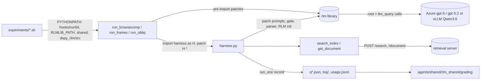

# Snippet REPL agent

A Recursive Language Model (RLM) agent for retrieval-heavy question answering and ranking. It is a harness around
the RLM paper's reference library, [`rlm`](https://github.com/alexzhang13/rlm) at commit `854e688`. The library is
not edited: every change is a runtime monkey-patch applied when `src/harness.py` is imported.

Everything below was checked against the code in `src/`, the launchers in `experiments/` and the `rlm` checkout.
Numbers in sections 11 and 12 come only from
[Experiments.xlsx](../../results/original_baselines/Experiments.xlsx). Files changed relative to the code that
produced the results, and every issue found, are listed in [CHANGES_FROM_ORIGINAL.md](CHANGES_FROM_ORIGINAL.md).
The scientific review is in [REVIEW_snippet_repl.md](../../docs/verification/REVIEW_snippet_repl.md).

## 1. Agent overview

For each question the model works in a persistent Python REPL, one turn at a time. In each turn it writes code in
```` ```repl ```` blocks. The REPL holds:

- **`search_index(query, top_k=5)`**: calls a retrieval server. It returns a Python list of `{doc_id, score, text}`
  dicts in which each `text` is cut to its first 512 tokens.
- **`get_document(doc_id)`**: the server's full text for one document, returned as a dict.
- **`llm_query` / `llm_query_batched`**: sub-LLM completions. The model uses them to read long text without
  printing it into its own context.
- **`answer`**: a dict. The run ends when the model sets `answer["content"]` and `answer["ready"] = True`.

Only what the model prints is returned to it on the next turn. The turn's response and printed output are appended
to the message history.

The name "snippet" sets it apart from the document REPL agent (`agents/document_repl`), which puts whole documents
into a variable. Here a search shows the model only a short head of each hit, and the model decides which documents
to open and read.

## 2. Research motivation

The harness docstring (`src/harness.py`) gives the motivation. Earlier work in this project used `dspy.RLM`, a
reimplementation of the RLM paper. This harness runs the **authors' own agent loop** instead. That loop has features
the earlier harness lacked:
- history compaction;
- an orchestrator prompt addendum;
- recursive sub-calls;
- per-iteration callbacks;
- a prompt with worked decomposition examples.

The authors ship no retrieval tools; their setting loads the corpus into the REPL variable `context`. So the harness
adds retrieval tools and rewrites the parts of the system prompt that assume `context` holds the corpus. In the
harness's own words, the arm tests "the authors' agent loop with a retrieval-adapted prompt", not the authors' prompt.

In the final table, each snippet REPL agent row is paired with a document REPL agent row on the same benchmark, model and retriever
(see [AGENT_COMPARISON.md](../../docs/experiments/AGENT_COMPARISON.md)).

## 3. The problem addressed

These are questions whose evidence is spread over documents in a corpus far too large to read (BrowseComp-Plus:
100,195 documents; FRAMES: a Wikipedia dump). The agent has to:
- decide what to search for;
- judge relevance from short snippets;
- choose which documents to read in full;
- combine the evidence into one exact answer.

On OBLIQ-Bench the output is instead an ordered list of document ids, scored by NDCG@10.

## 4. Methodology

**System prompt.** The library's `RLM_SYSTEM_PROMPT` is rewritten at import by assert-anchored patches. A patch whose
anchor text is missing raises an error instead of silently doing nothing. In the order applied:

1. Remove the "Your context is a str of N characters" line and the turn-0 "look at the context first" safeguard.
2. Raise the REPL output ceiling from 20,000 to 60,000 characters per code block, in both the enforced trim
   (`format_iteration`) and the prompt sentence.
3. Re-anchor ten sentences from "`context`" to "the corpus reached with `search_index` and `get_document`". The
   prompt tells the model to print snippets and to send fetched documents to `llm_query`.
4. Add "Every turn must execute code: never reply with prose alone ...", and rename the tool-list heading.
5. Add the weak-result rule: change the entity searched for, or commit to an answer.
6. Add the retriever line, "The index is a dense semantic retriever ... quotation marks have NO effect". This is on
   by default; `RETRIEVER_LINE=0` removes it.
7. Optional, off in every final row: the depth-2 line (`DEPTH2_PROMPT`) and the wide-search triage rule
   (`SEARCH_TRIAGE_RULE`).

With the settings of the final BrowseComp-Plus rows (`ORCHESTRATOR=0`), the system message is 3,779 characters,
measured with `tests/_probe.py`. `ORCHESTRATOR=0` drops the library's orchestrator addendum.

**Task text.** The question plus `TASK_SUFFIX` is passed as `root_prompt`, so it appears in the first user message as
"Answer the following: ...". With `LIGHTON_TASK_TEXT=1`, the setting of every final BrowseComp-Plus and FRAMES row,
the suffix is LightOn's deep-research template. It asks for `Explanation:` (with `[doc_id]` citations),
`Exact Answer:` and `Confidence:`. OBLIQ replaces the suffix with a ranking contract (section 9).

**search_index.**
- It POSTs `{query, top_k}` to `$EMBEDDING_SERVER_URL/search`.
- `top_k` defaults to `OFFICIAL_TOP_K`: 5 for BrowseComp-Plus and FRAMES, 20 for OBLIQ. This is a default, not a
  cap. The model may pass another value; overrides are counted in `topk_overrides` / `topk_requested`.
- Each hit's `text` is cut to the first 512 tokens of the Qwen/Qwen3-0.6B tokenizer (`SEARCH_SNIPPET_TOKENS=512`).
  The tokenizer comes from `dspy_rlm.agent`. There is no separate character cap; the 500-character cut
  (`SEARCH_SNIPPET_LEN`) applies only when `SEARCH_SNIPPET_TOKENS` is unset.
- The tool description shown to the model says "up to ~2000 characters (512 tokens) per hit".
- The cut is applied to whatever `text` the server returns; the harness comments state that for BrowseComp-Plus this
  is the document's opening.

**get_document.** It POSTs `{doc_id}` to `/document` and returns the server's JSON (`{doc_id, text}`) uncut. The model
is told to pass that text to `llm_query` rather than print it.

**Sub-LLM reading.** `llm_query(prompt)` and `llm_query_batched(prompts)` are plain completions with no REPL and no
retrieval.
- They run on the root model's deployment unless `SUB_LM_MODEL` is set; no final row sets it.
- They use `sub_sampling_args={"reasoning_effort": SUB_LM_REASONING_EFFORT}` (medium in every row).
- On Azure, effort is forwarded only when the `azure_sampling` or `run5d` startup hook is loaded (issue K3,
  section 13).
- `max_depth=1`, so `rlm_query` falls back to `llm_query`.
- At most 2 sub-calls run concurrently (`MAX_CONCURRENT_SUBCALLS`).

**Format gate.** `_AnswerDict.__setitem__` is patched. When `answer["ready"]` is set to a true value and the content
lacks either the regex `Explanation\s*:` or `Exact Answer\s*:` (case-insensitive):
- `ready` is reset to False;
- a `[SUBMISSION REJECTED k/3]` notice is printed for the model to read next turn.

After 3 rejections in a question the gate accepts anything. The counter resets per question. Citations and
`Confidence:` are not checked. `MAX_REJECTS=0` turns the gate off; `OBLIQ_NO_FORMAT_GATE=1` does this in the OBLIQ
runner, but no final row sets it.

**Compaction** (`--compaction`, the library's mechanism).
- Before each turn, the library counts the tokens of the message history. It uses tiktoken where available,
  otherwise about 4 characters per token.
- If the count reaches 85% of a context limit looked up from the model name (for Azure, the deployment name), the model is asked for a progress
  summary. The history is replaced by system message, first user message, summary and a "continue" message.
- The full history stays in the REPL variable `history`.
- The limit is the longest key of a fixed table contained in the model name: 272k tokens for names containing `gpt-5`,
  128k for names containing `qwen3` (this includes the served name `qwen36-35b-a3b`), 128k by default.

**Termination.** A question ends at the first of:
1. a turn in which `answer["ready"]` becomes true and passes the gate (or the gate is exhausted); the library returns
   `answer["content"]`;
2. `--max-iterations` turns. The library then makes one extra call, appending the assistant-role message "Please
   provide a final answer to the user's question based on the information provided.", and that reply becomes the
   prediction without going through the gate;
3. an exception (API error after retries, LM-call timeout), recorded as `predicted="ERROR"`, `correct=False`;
4. the launcher's per-question `timeout` (7,200 s or 3,600 s) or the cost watchdog, which leaves no record. Graders
   count a missing record as wrong.

The harness passes no `max_timeout`, `max_budget` or `max_errors` to the library.

## 5. Formulation of one question

```text
input:  question q, gold doc set G, evidence set E, budgets (T turns, optional search cap C)
R := {}                                   # doc ids seen by tools
H := [system(P), user("Answer the following: " + q + TASK)]
for t = 1..T:
    if compaction and tokens(H) >= 0.85 * L(model): H := [H0, H1, summary(H), "continue"]
    y_t := LM(H + [user("Turn t/T:")])
    blocks := repl_blocks(y_t)            # Qwen opt-ins may also run ```python / prose answers
    for b in blocks: out_b := exec(b)     # search_index adds every returned doc_id to R (searches beyond C are refused);
                                          # get_document(d) adds d to R; llm_query = LM_sub(prompt)
    if answer.ready set during t and gate(answer.content) (or 3 rejections already): return answer.content
    H := H + [assistant(y_t), user(concat(trim_60K(out_b)))]
return LM(H + [assistant("Please provide a final answer ...")])   # turn limit reached

record: gold_recall = |G ∩ R| / |G|   (0 if G = {}),   evid_recall = |E ∩ R| / |E|
        correct (in-run only) = heuristic substring match on the "Exact Answer" span, else LLM judge
```

R contains every id a search returned, whether or not the model printed it, plus every id passed to `get_document`.
The reported accuracy comes from a separate gpt-4.1 grading pass (section 7), not from the in-run `correct` field.

## 6. Implementation architecture

| File | Role |
|---|---|
| `src/harness.py` | Core. Applies all patches at import (instrumentation of `llm_query`, depth-2 fixes, format gate, prompt patches). Defines `make_tools`, `_tool_specs` (ours / LightOn's descriptions), `TASK_SUFFIX`, `run_one` (one question to one record) and `main` (BrowseComp-Plus from `Tevatron/browsecomp-plus`). |
| `src/run_browsecomp.py` | BrowseComp-Plus runner. Before importing the harness: LM-call timeout and Qwen sampling opt-ins (`QWEN_MAX_TOKENS`, `QWEN_PRESENCE_PENALTY`), `QWEN_FENCE_TOLERANT`. After: `QWEN_REPL_CUE`, `QWEN_PROSE_FINAL`, `BCP_SEARCH_CAP`. Then `H.main()`. |
| `src/run_frames.py` | FRAMES runner. Rebinds the harness's row accessors and judge. Adds `FRAMES_BM25_LINE`, `FRAMES_SEARCH_CAP`, `FRAMES_REPL_CUE`, `FRAMES_FENCE_TOLERANT`, `LOCAL_LM_TIMEOUT`. |
| `src/run_obliq.py` | OBLIQ runner. Rebinds accessors, task text and scorer (NDCG), replaces the STRATEGY prompt block, and adds OBLIQ opt-ins. |
| `src/prompt_modules.py` | Splits the patched system prompt into 6 named paragraphs (ROLE, REPL_TOOLS, OUTPUT_CAP, STRATEGY, TURN_FORM, TURN_RULE) and asserts a byte-identical round trip. Loaded by file path as `_opm`. |
| `src/hooks/*/sitecustomize.py` | Startup hooks, run by Python when the directory is first on `PYTHONPATH`. `retry429` (openai `max_retries` 10); `azure_sampling` (forward `sampling_args` such as `reasoning_effort` on Azure, and log per-call usage to `RLM_USAGE_LOG`); `cap_ranking` (OBLIQ document REPL only); `run5d` = the first three plus `balance_local` (start a Qwen question on the less loaded of :8030/:8031). |
| `agents/shared/rlm_shared/` | BrowseComp-Plus decryption and judge (`browsecomp_data`), OBLIQ loaders and NDCG (`obliq_data`), score-cutoff rewrites (`obliq_score_advice`), graders (`grading/`). |

**How the runtime patches work.** Python binds names at import time, so each patch replaces the name where the caller
looks it up:
- `rlm.core.rlm.RLM_SYSTEM_PROMPT`, `build_rlm_system_prompt`, `build_user_prompt`, `format_iteration` and
  `find_code_blocks` are replaced in `rlm.core.rlm`'s namespace, with `rlm.utils.prompts` kept in sync;
- `RLM.__init__`, `RLM.completion` and `LocalREPL._llm_query*` are wrapped on the class;
- the runners patch attributes of the harness module object (`H.make_tools`, `H.get_question`, `H.judge_match`,
  `H.TASK_SUFFIX`, `H.MAX_REJECTS`).

The OBLIQ runner rebinds the accessors on `rlm_shared.browsecomp_data` *before* importing the harness, so the harness's
`from ... import` picks up the OBLIQ versions.



## 7. Execution workflow

1. **Launcher** (`experiments/bcp_snip.sh`, `bcp_snip2.sh`, `frames_snip.sh`, `obliq_snip.sh` → `obliq_shard.sh`):
   - sources `configs/paths.env` (through `experiments/_common.sh`) and the Azure credential file;
   - checks the retrieval server (and the vLLM servers for Qwen);
   - exports the row's switches;
   - starts one Python process per question (`xargs -P W`, `timeout` per question). OBLIQ instead starts one process
     per shard of the id list.
2. **Runner**: patches the harness and loads the question.
3. **`run_one`**: builds the tools and an `RLM(...)` (Azure backend, or vLLM when `LOCAL_LLM_BASE_URL` is set), calls
   `rlm.completion(question + TASK, root_prompt=question + TASK)`, and writes the record. Fields:
   - `predicted`, in-run `correct`;
   - `gold_recall`, `evid_recall`;
   - tool counts, `format_rejections`, latency;
   - the token fields, which are unreliable (K11).

   `RLMLogger` writes one trajectory JSONL per question to `RLM_TRAJ_DIR`. The `run5d` hook appends one line per
   Azure call to `RLM_USAGE_LOG`.
4. **Outputs**:
   - BrowseComp-Plus: `<out>/q<idx>.json` and `.log`;
   - FRAMES: `<out>/q<NNN>.json`;
   - OBLIQ: `<out>/all_s<k>.json`, merged into `<out>/all.json` (every question appears twice, K19).
5. **Grading**, in `agents/shared/rlm_shared/grading/`, separate from the run:
   - `grade_bcp_snippet.py <run_dir>`: gpt-4.1, official template, 3 votes, majority;
   - `grade_frames.py <run_dir>`;
   - `obliq_report.py snip <task> <run_dir> [ids.json]`: NDCG/Recall from the parsed ranking, no LLM;
   - BCP-9 and BCP-11 were re-judged with `rejudge_bcp.py` from their stored answers.

   A question without a record counts wrong (zero NDCG on OBLIQ).

## 8. Important parameters

"Default" is the code default when the variable is unset. Rows: GPT-5 BCP = BCP-13; Sept = BCP-9/11; Qwen BCP =
BCP-15/17/19; FR = FR-7/9; OBLIQ = MAT-9/TWI-9/CON-9. Exact per-row values are in `configs/<ID>.env`.

| Parameter | Env var / flag | Default | Final rows |
|---|---|---|---|
| Retrieval server | `EMBEDDING_SERVER_URL` | `http://localhost:8024` | :8001 Qwen3-Embedding-8B (BCP-9, -15); :8024 Reason-ModernColBERT (BCP-11, -17); :8044 BM25 (BCP-13, -19); :8040 BM25 Wikipedia (FR); :8014/:8021/:8022 Gemini-Embedding-2 (MAT/TWI/CON) |
| Results per search | `OFFICIAL_TOP_K` | 5 (default, model may override) | 5 (BCP, FR); 20 (OBLIQ) |
| Snippet length | `SEARCH_SNIPPET_TOKENS` / `SEARCH_SNIPPET_LEN` | unset → 500 characters | 512 tokens (all) |
| REPL output ceiling | `RLM_MAX_OUTPUT_CHARS` | 60,000 chars per block | 60,000 (all) |
| Orchestrator addendum | `ORCHESTRATOR` | 1 (on) | 0 (all) |
| Tool descriptions / task text | `LIGHTON_TOOL_DOCS`, `LIGHTON_TASK_TEXT` | off | 1 (all; OBLIQ replaces the task text) |
| Dense-retriever sentence | `RETRIEVER_LINE` | 1 (on) | on (BCP, including BM25 rows); 0 + `FRAMES_BM25_LINE=1` (FR) |
| Root effort | `AZURE_OPENAI_REASONING_EFFORT` | high | high (GPT-5, GPT-5.2); medium (Qwen); BCP-9/11 not sent (K3) |
| Sub-LLM effort | `SUB_LM_REASONING_EFFORT` | medium | medium (all) |
| Sub-LLM model | `SUB_LM_MODEL` | root model | root model (all) |
| Turn limit | `--max-iterations` | 100 | 100 (GPT-5 BCP, Sept); 50 (Qwen BCP, FR); 12 (OBLIQ) |
| Recursion depth | `--max-depth` | 1 | 1 |
| Compaction | `--compaction` | off | on (BCP-13/15/17/19, FR); off (Sept, OBLIQ) |
| Search cap | `BCP_SEARCH_CAP` / `FRAMES_SEARCH_CAP` | none | none (GPT-5 BCP, Sept, OBLIQ); 25 (Qwen BCP, FR) |
| Format gate | `MAX_REJECTS` / `OBLIQ_NO_FORMAT_GATE` | 3 rejections | 3 (all, including OBLIQ; K6) |
| Output tokens per call | `QWEN_MAX_TOKENS` | server default | 8,192 (Qwen BCP) |
| Presence penalty | `QWEN_PRESENCE_PENALTY` | none | 1.5 (Qwen BCP) |
| Code-fence tolerance | `QWEN_FENCE_TOLERANT` / `FRAMES_FENCE_TOLERANT` | off | on (Qwen BCP, FR-9) |
| REPL-fence cue | `QWEN_REPL_CUE` / `FRAMES_REPL_CUE` / `OBLIQ_REPL_CUE` | off | on (Qwen BCP, FR-9, all OBLIQ) |
| Prose answer accepted | `QWEN_PROSE_FINAL` | off | on (Qwen BCP) |
| LM-call timeout | `LOCAL_LM_TIMEOUT` | library 300 s | 1,800 s (Qwen rows, OBLIQ); 300 s (GPT-5 BCP, FR-7) |
| Per-question time limit | launcher `timeout` | none | 7,200 s (GPT-5 BCP, FR); 3,600 s (Qwen BCP); none (Sept, OBLIQ) |
| Concurrent sub-calls | `MAX_CONCURRENT_SUBCALLS` | 2 | 2 |

## 9. Benchmark integrations

- **BrowseComp-Plus** (`run_browsecomp.py` → `harness.main`): questions from the Hugging Face dataset
  `Tevatron/browsecomp-plus` (test split, 830 questions). The question, answer and gold/evidence doc ids are decrypted
  by `rlm_shared.browsecomp_data`. In-run judge: a heuristic substring match on the `Exact Answer` span, else an Azure
  LLM judge. One process per question index.
- **FRAMES** (`run_frames.py`): rows from `$FRAMES_DATA_DIR/frames_rows.json` (824 questions). Gold article ids serve
  as both gold and evidence. Changes from BrowseComp-Plus:
  - the dense-retriever sentence is swapped for a BM25 sentence (`RETRIEVER_LINE=0`, `FRAMES_BM25_LINE=1`);
  - a hard search budget (`FRAMES_SEARCH_CAP=25`): after 25 calls the tool returns an error hit instead of results,
    and the system prompt states the budget;
  - the in-run judge runs on the local model server (`LOCAL_JUDGE_BASE_URL`);
  - the record also gets `reasoning_types`.
- **OBLIQ-Bench** (`run_obliq.py`): queries and qrels from `$OBLIQ_BENCH_ROOT`. Changes:
  - The task text is replaced by a ranking contract: the answer is a newline-separated list of doc ids. Math and
    Congress load it from `configs/obliq/<task>/task_snippet.txt`; Twitter uses the built-in text.
  - The STRATEGY paragraph of the system prompt is replaced (built-in or `strategy_snippet.txt`).
  - `OBLIQ_RELATIVE_SCORES=1` rewrites fixed score cutoffs into relative advice.
  - `OBLIQ_TAG_SEARCH=1` adds a per-question `tag` to every `/search` request.
  - The judge is replaced by NDCG@k against the qrels; `correct` means NDCG@10 > 0.
  - Questions are sharded over 5 processes by `obliq_shard.sh`. Retrieval is Gemini-Embedding-2 over raw text; Math
    goes through a proxy that drops each query's own problem.

## 10. Associated experiments

| ID | Document |
|---|---|
| BCP-9 | [BCP-9_browsecomp-plus-gpt-5-qwen3-embedding-8b.md](../../docs/experiments/snippet_repl/BCP-9_browsecomp-plus-gpt-5-qwen3-embedding-8b.md) |
| BCP-11 | [BCP-11_browsecomp-plus-gpt-5-reason-moderncolbert.md](../../docs/experiments/snippet_repl/BCP-11_browsecomp-plus-gpt-5-reason-moderncolbert.md) |
| BCP-13 | [BCP-13_browsecomp-plus-gpt-5-bm25.md](../../docs/experiments/snippet_repl/BCP-13_browsecomp-plus-gpt-5-bm25.md) |
| BCP-15 | [BCP-15_browsecomp-plus-qwen3-6-35b-a3b-fp8-qwen3-embedding-8b.md](../../docs/experiments/snippet_repl/BCP-15_browsecomp-plus-qwen3-6-35b-a3b-fp8-qwen3-embedding-8b.md) |
| BCP-17 | [BCP-17_browsecomp-plus-qwen3-6-35b-a3b-fp8-reason-moderncolbert.md](../../docs/experiments/snippet_repl/BCP-17_browsecomp-plus-qwen3-6-35b-a3b-fp8-reason-moderncolbert.md) |
| BCP-19 | [BCP-19_browsecomp-plus-qwen3-6-35b-a3b-fp8-bm25.md](../../docs/experiments/snippet_repl/BCP-19_browsecomp-plus-qwen3-6-35b-a3b-fp8-bm25.md) |
| FR-7 | [FR-7_frames-gpt-5-bm25.md](../../docs/experiments/snippet_repl/FR-7_frames-gpt-5-bm25.md) |
| FR-9 | [FR-9_frames-qwen3-6-35b-a3b-fp8-bm25.md](../../docs/experiments/snippet_repl/FR-9_frames-qwen3-6-35b-a3b-fp8-bm25.md) |
| MAT-9 | [MAT-9_obliq-bench-math-analogues-gpt-5-2-gemini-embedding-2.md](../../docs/experiments/snippet_repl/MAT-9_obliq-bench-math-analogues-gpt-5-2-gemini-embedding-2.md) |
| TWI-9 | [TWI-9_obliq-bench-twitter-conflict-descriptive-gpt-5-2-gemini-embedding-2.md](../../docs/experiments/snippet_repl/TWI-9_obliq-bench-twitter-conflict-descriptive-gpt-5-2-gemini-embedding-2.md) |
| CON-9 | [CON-9_obliq-bench-congress-hearings-tip-of-the-tongue-gpt-5-2-gemini-embedding-2.md](../../docs/experiments/snippet_repl/CON-9_obliq-bench-congress-hearings-tip-of-the-tongue-gpt-5-2-gemini-embedding-2.md) |

### Follow-up runs

- **TWQ-1**: OBLIQ-Twitter with Qwen3.6 and plain dense search (dev100 + rest181), the control of SP-6:
  `experiments/obliq_twitter_qwen36.sh`, `configs/TWQ-1.env`, [TWQ-1](../../docs/experiments/snippet_repl/TWQ-1.md).
- **SP-6** (search policy on OBLIQ-Twitter) and **GEPA-4** (GEPA on OBLIQ-Twitter, Qwen3.8-27B) run this agent; see
  [studies/](../../studies/README.md).

## 11. Existing results and findings

All values are copied from [Experiments.xlsx](../../results/original_baselines/Experiments.xlsx). BrowseComp-Plus
and FRAMES accuracy is judged by gpt-4.1. The Recall column is not defined the same way in every row (K4 in
[KNOWN_ISSUES.md](../../docs/verification/KNOWN_ISSUES.md)).

**BrowseComp-Plus (830 questions)**

| Row | Model (reasoning) | Retriever | Accuracy | Recall | Searches / q | Turns / q |
|---|---|---|---|---|---|---|
| BCP-9 | GPT 5 (high)* | Qwen3-Embedding-8B | 0.794 | 0.804 | 29.5 | 5.6 |
| BCP-11 | GPT 5 (high)* | Reason-ModernColBERT | 0.8578 | 0.824 | 22.3 | 4.7 |
| BCP-13 | GPT 5 (high)* | BM25 (k1 0.9, b 0.4) | 0.6747 | 0.6815 | 60.87 | 8.3 |
| BCP-15 | Qwen3.6 | Qwen3-Embedding-8B | 0.380 † (276/830 done) | 0.4979 | 19.23 | 14.6 † |
| BCP-17 | Qwen3.6 | Reason-ModernColBERT | (empty: queued) | | | |
| BCP-19 | Qwen3.6 (medium) | BM25 (k1 0.9, b 0.4) | 0.2494 | 0.3571 | 20.15 | 15.4 |

The workbook's footnotes:
- \* the sub-LLM runs at medium. For BCP-9 and BCP-11 the effort was not actually sent (K3).
- † still running at the workbook date, 2026-10-30 08:40.
- BCP-19: 243 of 830 questions hit the 1 h limit and count as wrong.

**FRAMES (824 questions)**: FR-7 GPT 5 (high)*, BM25: accuracy **0.7633**, recall 0.6716, 6.59 searches, 2.6 turns.
FR-9 Qwen3.6 (medium), BM25: accuracy **0.6201**, recall 0.5752, 12.85 searches, 10.9 turns.

**OBLIQ (GPT 5.2 (high)*, Gemini-Embedding-2)**

| Row | Recall@10 | NDCG@10 (gold / pooled) | NDCG@50 (gold / pooled) | Searches / q | Turns / q |
|---|---|---|---|---|---|
| MAT-9 (151 q) | 0.1409 | 0.1489 / 0.1954 | 0.1437 / 0.1834 | 28.26 | 12.1 |
| TWI-9 (281 q) | 0.1058 | 0.1019 / 0.1607 | 0.1168 / 0.1765 | 34.36 | 12 |
| CON-9 (254 q) | 0.2008 | 0.1876 | 0.1907 | 54.54 | 12.4 |

What the table shows, read against the comparison caveats in
[AGENT_COMPARISON.md](../../docs/experiments/AGENT_COMPARISON.md):
- With GPT-5 on BrowseComp-Plus, accuracy is highest with Reason-ModernColBERT and lowest with BM25. The BM25 row also
  has the most searches and turns.
- Qwen3.6 rows score far below GPT-5 rows under tighter budgets (25 searches, 50 turns, 1 h).
- The OBLIQ rows average 12.0-12.4 turns against a 12-turn limit, where a run that hits the limit counts 13 (the forced
  final-answer turn): many questions ran out of turns.

A snippet REPL ↔ document REPL pair compares the whole package (budgets, caps, time limits), not the reading strategy alone
(K2).

## 12. Computational characteristics

Per question, from the workbook. Cost is in USD at list prices; "cached" uses cached-input pricing. Tokens cover
root + sub-LLM calls.

| Row | Time / q | Uncached cost / q | Cached cost / q | Input tokens / q | Output tokens / q |
|---|---|---|---|---|---|
| BCP-9 | 191 s | ≈ 0.50 | not logged | ≈ 267,564 | ≈ 16,474 |
| BCP-11 | 166 s | ≈ 0.36 | not logged | ≈ 180,623 | ≈ 13,144 |
| BCP-13 | 452 s | 1.1999 | 0.9737 | 638,846 | 40,138 |
| BCP-15 | 874 s † | local GPU | local GPU | not logged | not logged |
| BCP-19 | 1098 s | local GPU | local GPU | not logged | not logged |
| FR-7 | 107 s | 0.146 | 0.1424 | 35,135 | 10,206 |
| FR-9 | 903 s | local GPU | local GPU | not logged | not logged |
| MAT-9 | 372 s | 0.8733 | 0.7603 | 238,340 | 32,583 |
| TWI-9 | 225 s | 0.6018 | 0.5161 | 196,280 | 18,451 |
| CON-9 | 365 s | 0.9152 | 0.7545 | 347,908 | 21,881 |

≈: the September runs' token logs were overwritten (K11); the workbook rebuilt them from trajectories. Qwen times are
measured with 8-16 questions sharing a GPU.

**Where the cost grows.** Every turn re-sends the whole message history: the system prompt, all previous responses and
all printed outputs, each block up to 60,000 characters. Input tokens therefore grow roughly with turns × accumulated
output. Printed search results (5 hits × up to 512 tokens each) and printed documents add to every later turn.
`llm_query` calls add their own input, but their text does not enter the root history unless printed.
- BCP-13 (BM25) needs 2.7× the searches, 1.8× the turns and 3.5× the input tokens of BCP-11 (ColBERT).
- Compaction bounds the history only once it reaches 85% of the model's context limit.
- No row sets a dollar budget. BCP-13 ran with a per-question cost watchdog (kill at $10).

## 13. Limitations

Detailed in [KNOWN_ISSUES.md](../../docs/verification/KNOWN_ISSUES.md):

- **K2**: Snippet REPL and document REPL rows differ in search cap, turn limit, time limit and ColBERT index length. A pair
  compares packages.
- **K3**: `reasoning_effort` reaches Azure only with the `azure_sampling`/`run5d` hook. BCP-9 and BCP-11 ran at the
  deployment default.
- **K6**: the OBLIQ rows ran with the BrowseComp format gate on. It rejected doc-id rankings on almost every question.
- **K7**: unfinished questions (time limit, watchdog, API error) are scored wrong.
- **K8**: the harness version that produced BCP-9 and BCP-11 is not preserved, and four of five BCP-11 launchers are
  lost.
- **K11**: the `iterations` and `input_tokens` record fields are wrong; use trajectories and `usage.jsonl`.
- **K13**: `bcp_snip.sh` says GPT runs have no compaction, but it passes `--compaction` (BCP-13 ran with it).
- **K15**: the in-run judge model came from an implicit `.env` loaded by `dspy_rlm.agent`.
- **K17**: `heuristic_match` counts an empty prediction as correct (in-run field only).
- **K19**: every OBLIQ question appears twice in `all.json`.
- **K23**: fence tolerance, REPL cue, search cap and LM-timeout code are duplicated across runners.

Further points found in the review are listed in
[REVIEW_snippet_repl.md](../../docs/verification/REVIEW_snippet_repl.md): the format gate can be bypassed by rebinding
`answer`; BM25 BrowseComp-Plus rows tell the model the index is dense; and the compaction limit for Qwen is 128k.

## 14. Installation

1. **rlm library**: check out github.com/alexzhang13/rlm at commit `854e688`. It is used from `PYTHONPATH`, not
   installed. Set `RLMLIB_PATH` to the checkout in `configs/paths.env`, copied from `configs/paths.example.env`.
2. **Python 3.12** with the packages in the repository's `requirements.txt`. The code uses `openai`, `requests`,
   `datasets` (BrowseComp-Plus questions), `transformers` (Qwen3-0.6B snippet tokenizer), `dspy` and `python-dotenv`
   (pulled in by `dspy_rlm.agent`, which provides the tokenizer), and `rlm`'s own dependencies.
3. **Settings**, in `configs/paths.env`:
   - `PYTHON`, `HF_HOME`, `RUNS_DIR`;
   - `AZ_ENV`: a file defining `AZ_EP` and `AZ_KEY`;
   - `AZURE_DEPLOYMENT_GPT5` and `AZURE_DEPLOYMENT_GPT52`;
   - `FRAMES_DATA_DIR`, `OBLIQ_BENCH_ROOT`.
4. **Servers**, set up as in [benchmarks/README.md](../../benchmarks/README.md):
   - a retrieval server speaking the rlm wire format (`POST /search {query, top_k}` → `{results: [{doc_id, score,
     text}]}`, `POST /document {doc_id}`, `GET /health`) on the row's port;
   - for Qwen3.6 rows, vLLM serving `qwen36-35b-a3b` on :8030 and :8031;
   - for FRAMES, the in-run judge on :8030.

## 15. How to run

**These commands launch real model calls (Azure or vLLM) and need the servers of section 14. They cost money or GPU
time.**

One question, BrowseComp-Plus q0 with the BCP-13 settings. The arguments are model, retriever, output directory,
workers, first question and last question (exclusive):

```bash
cd /path/to/rlm-research-artifact
agents/snippet_repl/experiments/bcp_snip.sh gpt5 http://localhost:8044 "$RUNS_DIR/try_bcp" 1 0 1
# -> $RUNS_DIR/try_bcp/q0.json, q0.log, traj/, usage.jsonl
```

One experiment (one workbook row):

```bash
agents/snippet_repl/experiments/run_config.sh agents/snippet_repl/configs/FR-7.env
```

`run_config.sh` sources `configs/paths.env` and the row config, then runs the launcher named in it with its arguments.

## 16. How to reproduce the existing experiments

| Rows | Command | Grading |
|---|---|---|
| BCP-13, FR-7, FR-9, MAT-9, TWI-9, CON-9, BCP-19, BCP-15, BCP-17 | `experiments/run_config.sh configs/<ID>.env` (the three Qwen BCP rows also run in sequence through `experiments/qwen_bcp_snip_queue.sh`) | `agents/shared/rlm_shared/grading/grade_bcp_snippet.py <dir>`; `grade_frames.py <dir>`; `obliq_report.py snip <task> <dir> configs/obliq/<task>/<ids>.json` |
| BCP-9 | `experiments/run_config.sh configs/BCP-9.env` (`september/bcp_snip_qwen_embed.sh`) | `rejudge_bcp.py` re-judged the stored answers; for new runs, `grade_bcp_snippet.py` gives the same judge |
| BCP-11 | only the rlmfix24 subset can be relaunched (`NOORCH_QIDS_FILE=...`); the other launchers are lost (K8) | as BCP-9 |

Caveats:
- BCP-9 and BCP-11 were produced by an unpreserved harness version (K8), and their launchers loaded no effort hook
  (K3). A re-run with `src/` uses identical prompts and tools under their settings, but should be treated as a new run.
- The run5d launchers set the same switches as the original runs. Outputs differ run to run because the models sample.
- Ops scripts (`experiments/ops/`, `question_watchdog.sh`, `budget_guard.sh`) only grade, watch spend or change
  parallelism. BCP-13 ran with `question_watchdog.sh <dir> 5 10`.

## 17. Lightweight tests

Mocks only: no network, no model and no retrieval server. Takes a few seconds.

```bash
RLMLIB_PATH=/path/to/rlm python -m pytest agents/snippet_repl/tests
```

The tests cover:
- original vs refactored equivalence in separate interpreters (prompts, tool specs, task text, message list, gate,
  parser, records, `RLM` kwargs) over 9 scenarios;
- recall on a synthetic record;
- the format gate and final-answer extraction;
- static checks (string constants, `bash -n`, every config names an existing launcher).

Without `rlm` importable, 18 tests are skipped with a reason. See
[TESTING_REPORT.md](../../docs/verification/TESTING_REPORT.md).
