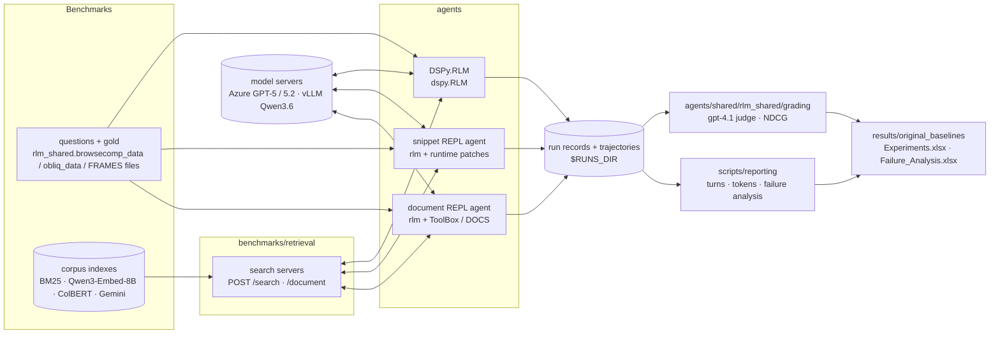

# Architecture

## Components



| Layer | Directory | Shared or per agent |
|---|---|---|
| Configuration (machine paths, credentials, deployments) | `configs/paths.example.env`, `agents/shared/rlm_shared/paths.py` | shared |
| Benchmark data access | `agents/shared/rlm_shared/browsecomp_data.py`, `obliq_data.py`, `obliq_score_advice.py` | shared |
| Retrieval servers and index builders | `benchmarks/retrieval/` | shared |
| Agent harness | `agents/<agent>/src/` | per agent |
| Experiment launchers and exact configurations | `agents/<agent>/experiments/`, `configs/<ID>.env` | per agent |
| Code that produced the results (verbatim) | `agents/<agent>/original/`, `agents/shared/original/` | per agent |
| Judging and scoring | `agents/shared/rlm_shared/grading/`, `agents/shared/rlm_shared/metrics.py` | shared |
| Reporting | `scripts/reporting/` (turn and token counts, failure analysis) | shared |
| Provenance, audit and documentation generators | `scripts/provenance/`, `scripts/audit/`, `scripts/docs/` | shared |
| Experiment registry | `experiments/registry.yaml` | shared |

The agents import shared code and never each other. There is one exception, recorded in the snippet REPL agent's change
record (S16): its snippet truncation loads the Qwen3-0.6B tokenizer through `dspy_rlm.agent`. The document REPL judge
templates (`agents/document_repl/src/judge.py`) are imported by `agents/shared/rlm_shared/grading/bcp_judge.py`. All BrowseComp+
grading uses them.

## Retrieval contract

Every agent talks to retrieval through one HTTP wire format, so retrievers can be swapped without touching an agent:

```
POST /search    {"query": str, "top_k": int, ["index": str], ["tag": str]}  ->  {"results": [{"doc_id", "score", "text"}]}
POST /document  {"doc_id": str}                                             ->  {"doc_id", "text"}
GET  /health
```

Servers cut `text` to 2,000 characters. The snippet REPL agent then truncates it to 512 tokens. The document REPL agent requests full
text through its own ToolBox protocol. Scores carry no information for BM25 and ColBERT (the ColBERT proxy returns 1/rank).

## Execution flow of one experiment

1. `set -a; . configs/paths.env; . agents/<a>/configs/<ID>.env; set +a`: machine paths, credentials file, the exact
   environment switches and arguments of the row.
2. The launcher in `agents/<a>/experiments/` starts one process per question, in parallel with `xargs -P`, under a
   per-question `timeout`. It puts the `rlm` checkout and, for Azure runs, a startup hook on `PYTHONPATH`. The hook
   forwards `reasoning_effort`, retries HTTP 429 and logs usage.
3. The harness loads the question, runs the REPL loop against the model server and the search server, and writes the
   record and the trajectory under `$RUNS_DIR/<run>/`.
4. A grader in `agents/shared/rlm_shared/grading/` judges every answer (gpt-4.1, 3 votes, cached) or scores the ranking
   (NDCG). It writes `graded_gpt41.json` and prints the workbook numbers.
5. `scripts/reporting/` adds turn counts (from trajectories), token and cost columns (from `usage.jsonl`) and the
   failure analysis.

## Results management

- **Results kept in the repository.** `results/original_baselines/` holds the results as reported (the workbooks).
  The per-question records and trajectories are not in the repository (431 GB). They stay on the machine that ran the
  experiments, and the experiment documents give their paths.
- **Checks.**
  - [`scripts/audit/recompute_experiments.py`](../../scripts/audit/recompute_experiments.py) recomputes the workbook
    from those records.
  - [`scripts/provenance/preserve_originals.py --check`](../../scripts/provenance/preserve_originals.py) verifies that
    `original/` is unchanged.
  - [`scripts/provenance/bcp_leak_scan.py`](../../scripts/provenance/bcp_leak_scan.py) verifies that no BrowseComp-Plus
    plain text is committed.
- **Experiment documents.** `docs/experiments/` is generated from `experiments/registry.yaml` and the evidence files
  (`scripts/docs/make_experiment_docs.py`, `make_comparison.py`).

## Refactoring policy

See [REFACTOR_RULES.md](REFACTOR_RULES.md). `src/` may differ from `original/` only by renames, import wiring,
parametrised paths and credentials, documentation and launchers. Each agent's `CHANGES_FROM_ORIGINAL.md` lists every
change, and tests compare the two (AST equality, identical prompts, tool specs, cache keys and records under mocks).
