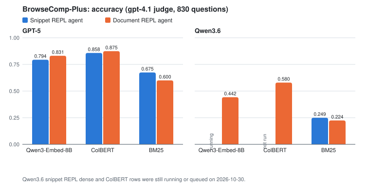
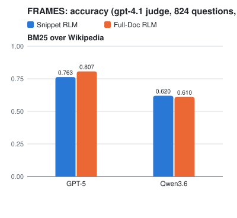
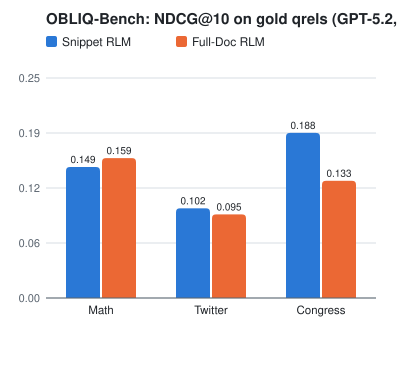

# Agent comparison

How the three agents compare on the benchmarks where comparable results exist. `scripts/docs/make_comparison.py`
reads every number in the tables and figures from
[Experiments.xlsx](../../results/original_baselines/Experiments.xlsx) or
[Failure_Analysis.xlsx](../../results/original_baselines/Failure_Analysis.xlsx). To change a number, regenerate the
file; do not edit numbers here. The workbook numbers were recomputed independently from the per-question records:
see [RESULT_INTEGRITY.md](../verification/RESULT_INTEGRITY.md).

## What is compared, and what is not

**Snippet REPL agent vs document REPL agent** is the comparison the final table was built for. Each pair shares the benchmark, the
model and the retriever. Scoring is also shared:
- BrowseComp-Plus and FRAMES: the same judge (gpt-4.1, 3 votes);
- OBLIQ: NDCG@10 on gold qrels.

**DSPy.RLM is not in this comparison.** It was evaluated in an earlier campaign (see
[its README](../../agents/dspy_rlm/README.md)) under a different protocol:
- a different judge (gpt-5.4-mini);
- a different retrieval setup (FAISS IVF index, top-10);
- different budgets (16 iterations, 35 searches);
- no FRAMES run.

Its rows were removed from the final table on 2026-10-28 and never re-run under the final protocol. Placing its
numbers next to these would compare protocols, not agents, so this document does not rank it.

**The two harnesses differ in more than their reading strategy.** Each pair of rows changes the harness, and with it
every setting below. A difference between two rows is the effect of the whole package, not of snippet-vs-full-document
reading alone.

| Setting | Snippet REPL agent | Document REPL agent |
|---|---|---|
| What a search returns | 5 results by default (the model may ask for more; BCP-19 did in 9 questions), each the first 512 tokens of the text the server returns, which servers cut to 2,000 chars | whole documents into `DOCS`, with k chosen by the model (≤ 50; mean 24.5 on BrowseComp-Plus BM25, 13.2 on FRAMES); fixed k = 20 on OBLIQ |
| Search cap | none (GPT-5 BrowseComp-Plus, OBLIQ); 25 (FRAMES, all Qwen3.6 rows) | 10, enforced in the client. The patched build behind BCP-23 logged up to 19 |
| Turn limit | 100 (GPT-5 BrowseComp-Plus); 50 (FRAMES, Qwen3.6 BrowseComp-Plus); 12 (OBLIQ) | 30, then a forced answer |
| Sub-LLM | `llm_query` is used for reading | the functions stay installed and only the prompt says not to use them (no call found in the OBLIQ trajectories) |
| Reasoning effort actually sent | BCP-9, BCP-11: deployment default (≈ medium), see [K3](../verification/KNOWN_ISSUES.md); BCP-13, FRAMES, OBLIQ: as labelled | BCP-21, BCP-23: unverified (unpreserved patched build); BCP-25: default (≈ medium); FRAMES, OBLIQ: as labelled |
| ColBERT index | 512-token documents | 8,192-token documents |
| Per-question time limit (Qwen3.6) | 1 h (BrowseComp-Plus), 2 h (FRAMES) | runaway kill only |

\* The "Recall" column uses five definitions across rows: gold vs evidence documents, and different denominators.
It is comparable only within one definition; see [RESULT_INTEGRITY.md §R1](../verification/RESULT_INTEGRITY.md).

## BrowseComp-Plus (830 questions)

| Agent | Model | Retriever | Accuracy | Recall* | Searches / q | Turns / q | Time / q | Uncached cost / q ($) |
|---|---|---|---|---|---|---|---|---|
| Snippet REPL agent | GPT-5 | Qwen3-Embed-8B | 0.794 | 0.804 | 29.5 | 5.6 | 191 s (3.2 min) | ≈ 0.50 |
| Snippet REPL agent | GPT-5 | ColBERT | 0.8578 | 0.824 | 22.3 | 4.7 | 166 s (2.8 min) | ≈ 0.36 |
| Snippet REPL agent | GPT-5 | BM25 | 0.6747 | 0.6815 | 60.87 | 8.3 | 452 s (7.5 min) | 1.1999 |
| Snippet REPL agent | Qwen3.6 | Qwen3-Embed-8B | 0.3675 | 0.4806 | 18.99 | 14.9 | 943 s (15.7 min) | local GPU (no API cost) |
| Snippet REPL agent | Qwen3.6 | ColBERT | 0.6012 | 0.647 | 15.59 | 13 | 1015 s (16.9 min) | local GPU (no API cost) |
| Snippet REPL agent | Qwen3.6 | BM25 | 0.2494 | 0.3571 | 20.15 | 15.4 | 1098 s (18.3 min) | local GPU (no API cost) |
| Document REPL agent | GPT-5 | Qwen3-Embed-8B | 0.8313 | 0.7619 | 7.9 | 11.2 | 300.2 s (5.0 min) | 0.4395 |
| Document REPL agent | GPT-5 | ColBERT | 0.8747 | 0.7875 | 8.12 | 10.8 | 482.5 s (8.0 min) | 0.5847 |
| Document REPL agent | GPT-5 | BM25 | 0.6 | 0.4973 | 9.2 | 18.2 | 567 s (9.5 min) | 0.9266 |
| Document REPL agent | Qwen3.6 | Qwen3-Embed-8B | 0.4422 | 0.3973 | 8.66 | 22.4 | 2439 s (40.6 min) | local GPU (no API cost) |
| Document REPL agent | Qwen3.6 | ColBERT | 0.5795 | 0.5123 | 8.6 | 20.9 | 1829 s (30.5 min) | local GPU (no API cost) |
| Document REPL agent | Qwen3.6 | BM25 | 0.2241 | 0.1806 | 9.7 | 27.3 | 1388 s (23.1 min) | local GPU (no API cost) |

## FRAMES (824 questions)

| Agent | Model | Retriever | Accuracy | Recall* | Searches / q | Turns / q | Time / q | Uncached cost / q ($) |
|---|---|---|---|---|---|---|---|---|
| Snippet REPL agent | GPT-5 | BM25 | 0.7633 | 0.6716 | 6.59 | 2.6 | 107 s (1.8 min) | 0.146 |
| Snippet REPL agent | Qwen3.6 | BM25 | 0.6201 | 0.5752 | 12.85 | 10.9 | 903 s (15.1 min) | local GPU (no API cost) |
| Document REPL agent | GPT-5 | BM25 | 0.807 | 0.7039 | 6.17 | 10.4 | 333 s (5.6 min) | 0.4161 |
| Document REPL agent | Qwen3.6 | BM25 | 0.6104 | 0.5981 | 7.6 | 20.2 | 394 s (6.6 min) | local GPU (no API cost) |

## OBLIQ-Bench (Math 151, Twitter 281, Congress 254 queries)

| Task | Agent | Recall@10 (G) | NDCG@10 (G / P) | NDCG@50 (G / P) | Searches / q | Turns / q | Time / q | Uncached cost / q ($) |
|---|---|---|---|---|---|---|---|---|
| Math | Snippet REPL agent | 0.1409 | 0.1489 / 0.1954 | 0.1437 / 0.1834 | 28.26 | 12.1 | 372 s (6.2 min) | 0.8733 |
| Math | Document REPL agent | 0.1361 | 0.1590 / 0.2024 | 0.1487 / 0.1879 | 10 | 15.4 | 494 s (8.2 min) | 0.7358 |
| Twitter | Snippet REPL agent | 0.1058 | 0.1019 / 0.1607 | 0.1168 / 0.1765 | 34.36 | 12 | 225 s (3.7 min) | 0.6018 |
| Twitter | Document REPL agent | 0.0951 | 0.0950 / 0.1800 | 0.1028 / 0.1814 | 10 | 8.5 | 179 s (3.0 min) | 0.271 |
| Congress | Snippet REPL agent | 0.2008 | 0.1876 | 0.1907 | 54.54 | 12.4 | 365 s (6.1 min) | 0.9152 |
| Congress | Document REPL agent | 0.1496 | 0.1332 | 0.1332 | 10 | 12.4 | 391 s (6.5 min) | 0.6271 |

NDCG is shown as G / P: against the gold qrels / against the pooled qrels. Congress has gold qrels only. WildChat and
Writing were not run, because no index was built for them.

## Paired tests on the same questions

Exact McNemar test on the questions that one row answers correctly and the other does not, from the Pairwise sheet of
Failure_Analysis.xlsx.

OBLIQ pairs are not tested here: NDCG is continuous, and the paired t statistics quoted in the original notes were not
recomputed for this repository.

| Comparison | A | B | Only A right | Only B right | McNemar p | p < 0.05 |
|---|---|---|---|---|---|---|
| Snippet REPL vs document REPL, GPT-5, Qwen3-Embed-8B | BCP-9 | BCP-21 | 57 | 88 | 0.012 | yes |
| Snippet REPL vs document REPL, GPT-5, Reason-ModernColBERT | BCP-11 | BCP-23 | 51 | 65 | 0.23 | no |
| Snippet REPL vs document REPL, GPT-5, BM25 | BCP-13 | BCP-25 | 136 | 74 | 2.3e-05 | yes |
| GPT-5 vs Qwen3.6, document REPL, Qwen3-Embed-8B | BCP-21 | BCP-27 | 332 | 9 | 7.1e-86 | yes |
| GPT-5 vs Qwen3.6, document REPL, Reason-ModernColBERT | BCP-23 | BCP-29 | 262 | 17 | 1.4e-57 | yes |
| GPT-5 vs Qwen3.6, document REPL, BM25 | BCP-25 | BCP-31 | 332 | 20 | 4.7e-74 | yes |
| ColBERT vs BM25, document REPL, GPT-5 | BCP-23 | BCP-25 | 255 | 27 | 1e-47 | yes |
| ColBERT vs BM25, snippet, GPT-5 | BCP-11 | BCP-13 | 196 | 44 | 4.4e-24 | yes |
| ColBERT vs dense, snippet, GPT-5 | BCP-11 | BCP-9 | 100 | 47 | 1.5e-05 | yes |
| Snippet REPL vs document REPL, GPT-5, BM25 (FRAMES) | FR-7 | FR-11 | 38 | 74 | 0.00086 | yes |
| Snippet REPL vs document REPL, Qwen3.6, BM25 (FRAMES) | FR-9 | FR-13 | 89 | 81 | 0.59 | no |
| GPT-5 vs Qwen3.6, document REPL (FRAMES) | FR-11 | FR-13 | 184 | 22 | 4.9e-33 | yes |
| GPT-5 vs Qwen3.6, snippet (FRAMES) | FR-7 | FR-9 | 168 | 50 | 4.1e-16 | yes |
| GPT-5 vs Qwen3.6, snippet, Qwen3-Embed-8B | BCP-9 | BCP-15 | 372 | 18 | 3.8e-87 | yes |
| GPT-5 vs Qwen3.6, snippet, Reason-ModernColBERT | BCP-11 | BCP-17 | 237 | 24 | 3.2e-45 | yes |
| GPT-5 vs Qwen3.6, snippet, BM25 | BCP-13 | BCP-19 | 380 | 27 | 7.1e-81 | yes |
| Snippet REPL vs document REPL, Qwen3.6, Qwen3-Embed-8B | BCP-15 | BCP-27 | 75 | 137 | 2.5e-05 | yes |
| Snippet REPL vs document REPL, Qwen3.6, Reason-ModernColBERT | BCP-17 | BCP-29 | 121 | 103 | 0.26 | no |
| Snippet REPL vs document REPL, Qwen3.6, BM25 | BCP-19 | BCP-31 | 82 | 61 | 0.094 | no |
| ColBERT vs dense, snippet, Qwen3.6 | BCP-17 | BCP-15 | 255 | 61 | 2.4e-29 | yes |

## What the evidence establishes

Each finding below is measured, and cites the pair that shows it.

1. **The retriever matters more than the harness.**
   - Within each harness, Reason-ModernColBERT beats BM25 by a wide margin: GPT-5 document REPL 255 vs 27 questions
     (p ≈ 1e-47); GPT-5 snippet REPL 196 vs 44 (p ≈ 4e-24).
   - Under the snippet REPL agent, ColBERT also beats the 8B dense retriever: 100 vs 47 (p ≈ 1.5e-5).
2. **The model matters more than the harness.** GPT-5 beats Qwen3.6-35B-A3B in all six tested pairs, across both
   benchmarks and both harnesses (p < 1e-15 in each).
3. **On BrowseComp-Plus with GPT-5, the better harness depends on the retriever.**
   - Dense retriever: Document REPL is ahead (88 vs 57, p = 0.012).
   - ColBERT: the two cannot be distinguished (65 vs 51, p = 0.23).
   - BM25: Snippet REPL is ahead (136 vs 74, p ≈ 2e-5).
4. **On FRAMES with GPT-5, document REPL is ahead** (74 vs 38, p ≈ 0.001). With Qwen3.6 the two cannot be distinguished
   (81 vs 89, p = 0.59).
5. **On OBLIQ the differences are small.**
   - Math and Twitter: NDCG@10 within 0.01 of each other, in opposite directions.
   - Congress: the snippet REPL agent is higher (0.188 vs 0.133).
   - Against the OBLIQ paper's multi-hop agent: all rows are below it on Math (0.161) and around it on Twitter (0.141)
     and Congress (0.183).

## What it does not establish

- **Why a harness wins.** Each harness win in finding 3 comes with a budget difference:
  - With BM25, the snippet REPL agent made 60.9 searches per question against document REPL's cap of 10.
  - With the dense retriever, the reasoning efforts differ in a way that is only partly known (BCP-9 ran at the
    default effort; BCP-21's effort is unverified).

  Isolating the reading strategy needs matched budgets: a document REPL run without the search cap, or a snippet REPL run with it.
- **An overall ranking of the three agents.** DSPy.RLM was not run under this protocol, and the snippet REPL vs
  Document REPL result changes sign with the retriever.
- **Run-to-run stability.**
  - Each cell is a single run, and the agents sample without seeds.
  - Run-to-run variation was never measured with two full runs. The 17.8 % figure of earlier documents is an
    extrapolation from a replay of 112 failed questions of one DSPy.RLM run (gpt-5 medium), assumed symmetric, and an
    upper bound ([KNOWN_ISSUES.md](../verification/KNOWN_ISSUES.md) K36). The direct measurements are small: three
    identical runs of 50 questions of a DSPy.RLM configuration (accuracy 0.76 / 0.90 / 0.82), and pairs of earlier GPT-5
    document REPL runs that fix ~45 % of wrong and break ~8 % of right answers on a re-run (VAR-2, not identical
    configurations; [FOLLOW_UP_STUDIES.md](FOLLOW_UP_STUDIES.md)).
  - Between unpaired rows, differences smaller than that should not be read as effects.
- **Like-for-like costs and times.** Times depend on how many runs shared a server, and the Qwen3.6 rows ran on local
  GPUs with no API cost.
